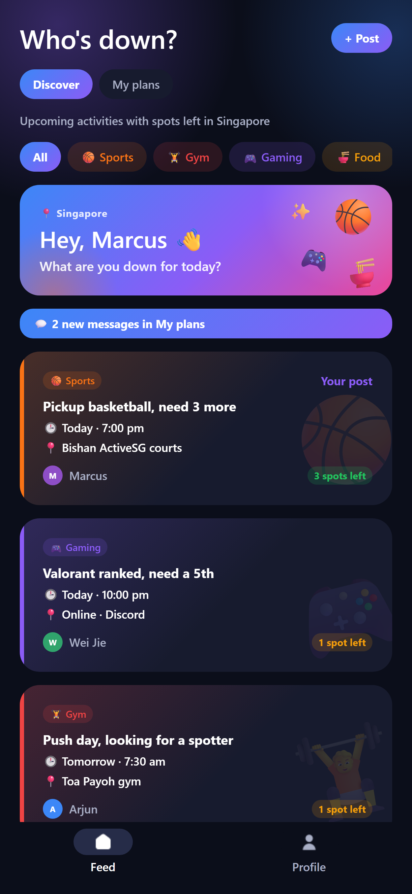
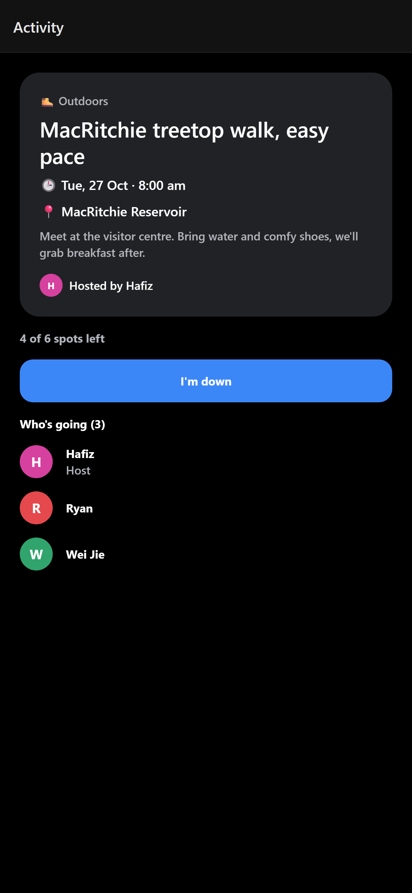
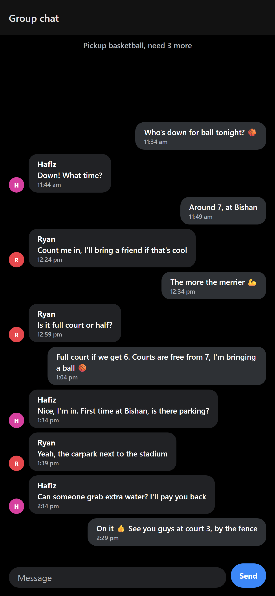
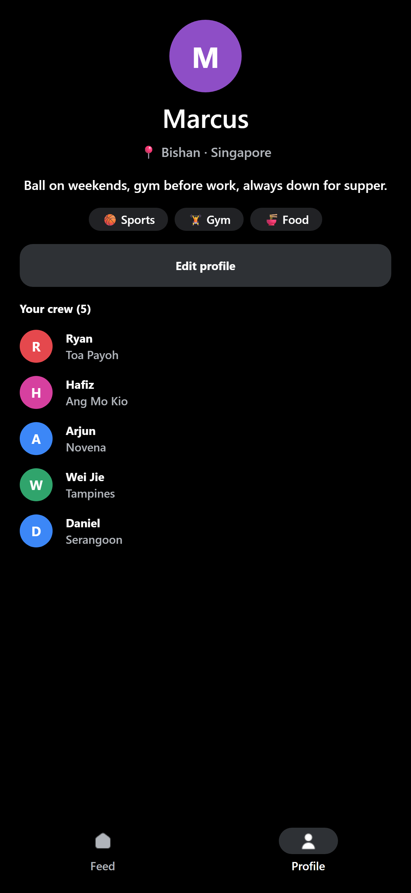

<p align="center">
  
</p>

<h1 align="center">Who's Down</h1>

<p align="center">
  <strong>Find people nearby to play, lift, game and hang out with.</strong><br />
  An activity-first mobile app that helps people make friends by doing things together.
</p>

<p align="center">
  <a href="https://github.com/dylanashleyalves/whos-down/actions/workflows/ci.yml"></a>
  
  
  
  
</p>

---

## Why I built this

A lot of guys find it hard to make new friends after school, after moving to a new city, or once their old friends get busy. Most friend-finding apps copy dating apps: you swipe, match, send an awkward "hey", and nothing happens.

But guys tend to bond **side by side, not face to face**: shooting hoops, lifting, gaming, grabbing food. So Who's Down skips the profiles-first approach and starts with **plans**. Someone posts "Pickup basketball Saturday, need 4 more", people nearby tap **I'm down**, and they show up. After the activity, if two people both tap **Hang again?**, they're added to each other's crew. That's how one-off meetups turn into friendships.

It started with guys in mind, and it's open to everyone: hosts can keep an activity guys-only or girls-only when that's what people want, or open it to all.

## Screenshots

| Feed | Activity | Group chat | Profile |
| :---: | :---: | :---: | :---: |
|  |  |  |  |

<sub>Screenshots use sample people and activities from the app's built-in demo screens (`src/app/demo`, development builds only).</sub>

## Features

**Plans, not profiles**
- Post an activity in seconds: what, category, where, when (tap a day and time) and how many more people you need
- **Discover** feed of upcoming activities with spots left, filterable by category (Sports, Gym, Gaming, Food, Outdoors, Hangout)
- **My plans** view of everything you're hosting or going to, including the last 30 days
- One-tap **I'm down** to join, with spots counting down and a list of who's going
- Hosts can edit or delete their own activities

**Staying in touch**
- Live **group chat** for each activity, for the host and everyone going
- One-on-one messages with your crew (people who picked each other on "Hang again?"), with read receipts
- In-app alerts and unread counts for new messages
- **Hang again?** after an activity. Choices stay private unless both people pick each other, and then they join each other's **crew**
- A friendly nudge for people who haven't been out in a week

**Ranks for showing up**
- Hosts check in who actually came, so only real meetups count, and no-shows lose XP
- XP for hosting, attending, meeting new people and seeing your crew again
- Ranks from 🌱 Rookie to 🏆 Legend, based on the last 90 days, plus weekly streaks
- Friendship levels with your crew (Met → Friend → Good friend → Day one) and a nudge when it's been a while

**Built for safety from day one**
- 18+ only: date of birth is checked at sign-up and stays private
- Open to everyone: hosts choose whether each activity is for everyone, guys only, or girls only (gender is private and only used for this), with community guidelines everyone agrees to
- Activities are only visible to, and joinable by, people in the **same country**
- **Report** people or activities, and **block** people both ways (hides activities and messages, blocks joins)
- One new post per person per day, to stop spam

## Tech stack

| Layer | Tools |
| --- | --- |
| Mobile app | [Expo](https://expo.dev) SDK 58, React Native, TypeScript (strict), [Expo Router](https://docs.expo.dev/router/introduction/) |
| Backend | [Supabase](https://supabase.com): Postgres, Auth, Realtime, Storage |
| Security | Postgres Row Level Security, `security definer` functions and triggers |
| Device | `expo-image-picker` for profile photos, `expo-localization` for the default country |
| Quality | ESLint, TypeScript, GitHub Actions CI |

## How it works

All business rules live in the database, not just the app, so they hold even if someone calls the API directly.

- **Row Level Security** on every table. For example, only the host and members can read a group chat, and you can only ever see your own "hang again" choices.
- **Triggers** enforce the rules that matter: no joining a full, started, blocked or other-country activity (with a row lock so two people can't take the last spot at once), 18+ birthdays, and one post per day.
- **Realtime** subscriptions power live chat and new-message alerts. Supabase applies the same RLS rules, so you only receive messages from chats you're in.
- **Mutual matching** for "hang again" runs in a `security definer` function, so neither person learns the other's choice unless it's mutual.

The schema is built up in plain SQL migrations in [`supabase/migrations`](supabase/migrations).

### Project structure

```
src/
  app/            Screens (Expo Router: every file is a route)
    (tabs)/       Feed and Profile tabs
    activity/     Activity details, joining, who's going
    chat/         Group chat
    ...           Sign-in, onboarding, posting, reporting, guidelines
  components/     Shared UI (forms, avatars, alerts, splash)
  lib/            Supabase client and data helpers
  providers/      Auth and profile state
supabase/
  migrations/     Database schema, security rules and triggers
```

## Run it yourself

**You'll need:** Node.js 20+, a free [Supabase](https://supabase.com) project, and the Expo Go app on your phone.

1. **Clone and install**

   ```bash
   git clone https://github.com/dylanashleyalves/whos-down.git
   cd whos-down
   npm install
   ```

2. **Set up the database.** In your Supabase project, open **SQL Editor** and run each file in [`supabase/migrations`](supabase/migrations) in order (`0001` → `0015`).

3. **Add your keys.** Copy `.env.example` to `.env.local` and fill in your Project URL and anon key from **Project Settings → API**.

4. **Start the app**

   ```bash
   npx expo start
   ```

   Scan the QR code with Expo Go. If your phone can't reach your computer, use `npx expo start --tunnel`.

### Checks

```bash
npm run typecheck
npm run lint
```

Both run automatically on every push and pull request via GitHub Actions.

## Roadmap

- [ ] Android build with EAS and a closed test on Google Play
- [ ] Push notifications (new messages, someone joined, "your game starts in an hour")
- [ ] "Within 10 km" using phone location
- [ ] Automated tests for the database rules
